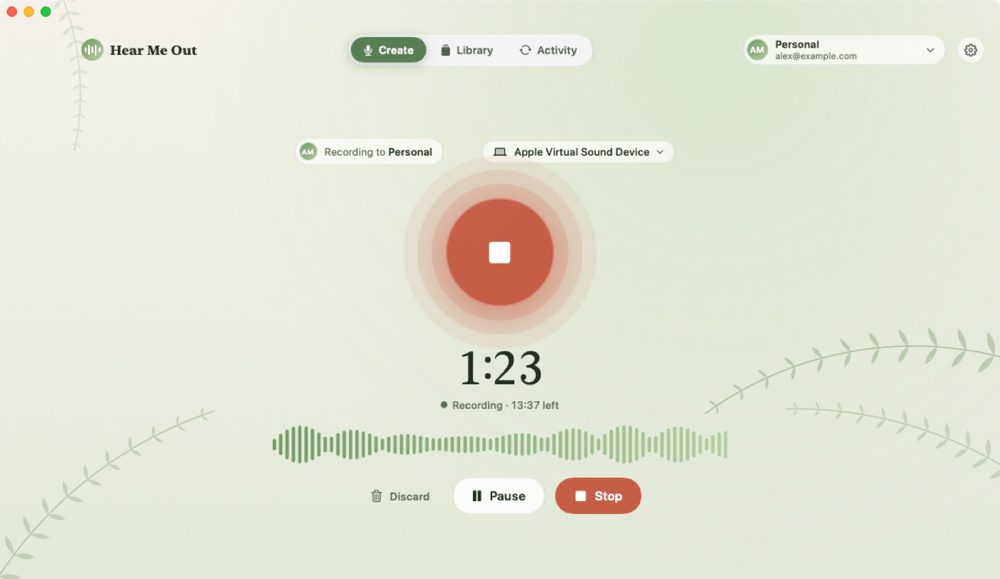
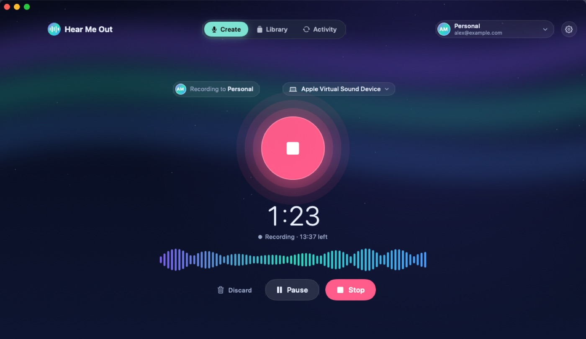
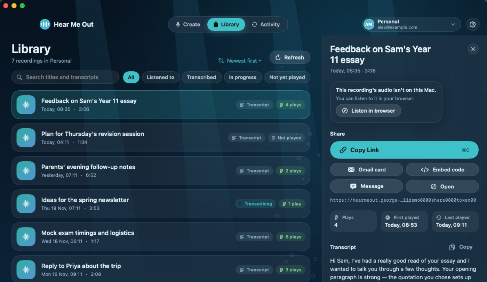
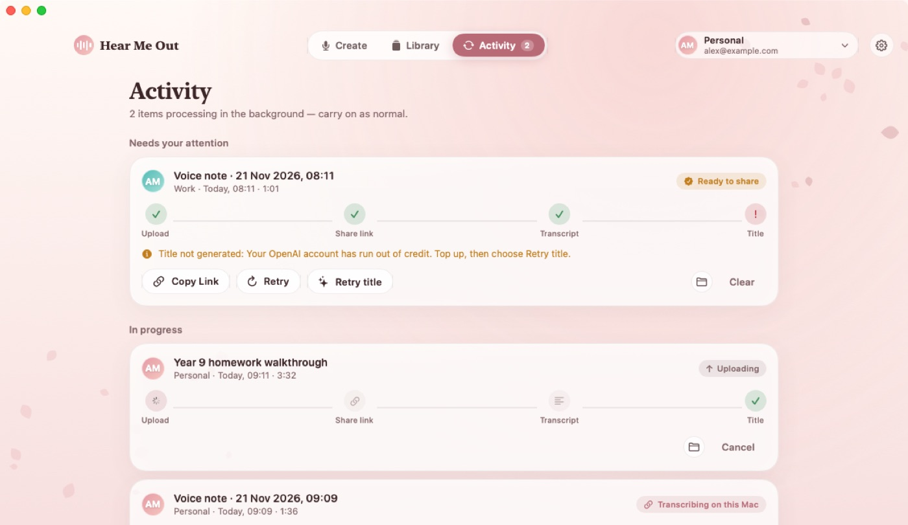
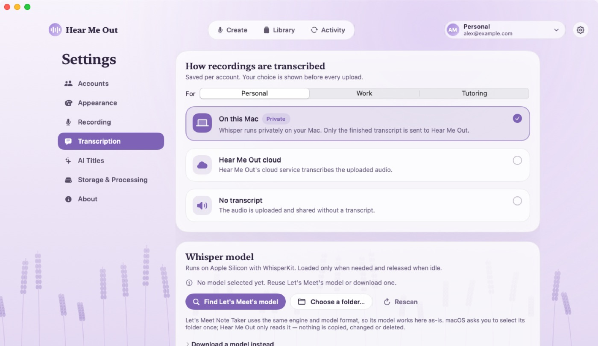
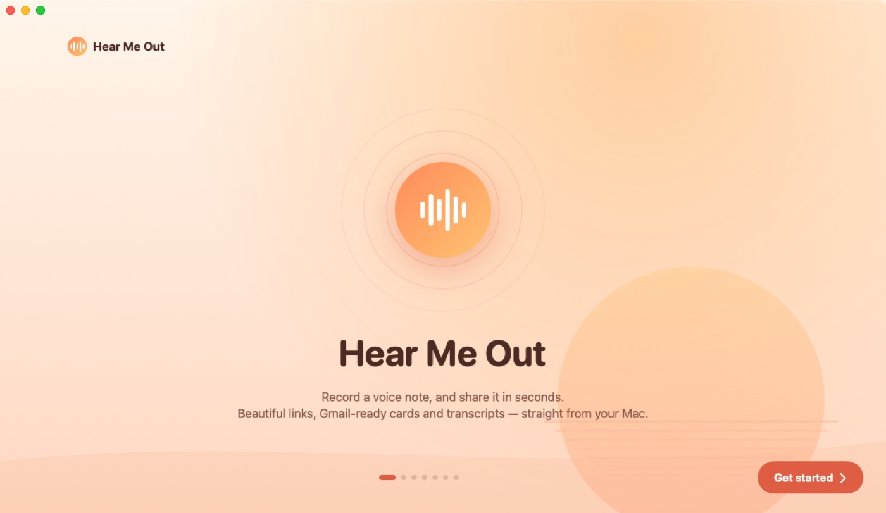
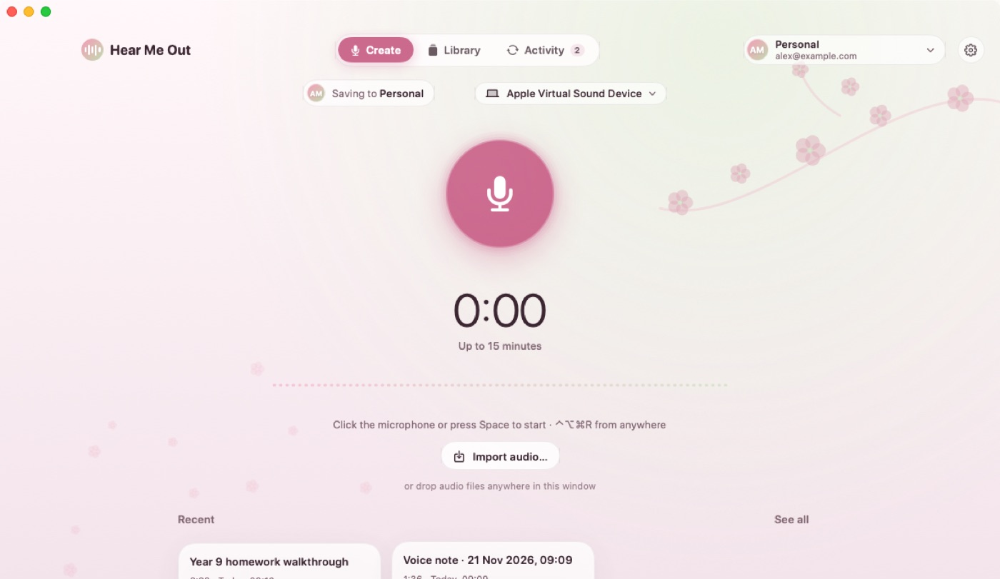
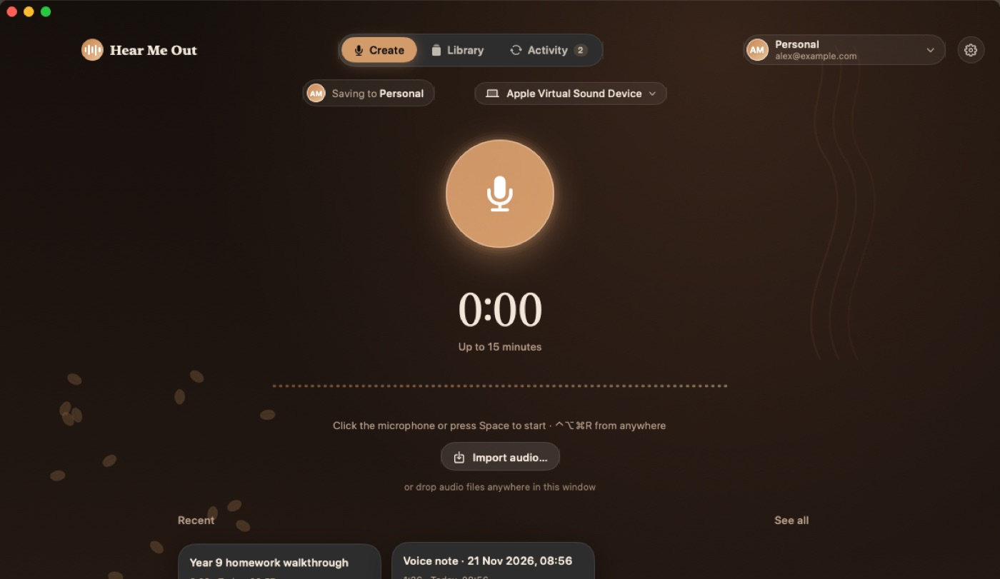

# Hear Me Out for Mac

A native Apple Silicon app for [Hear Me Out](https://hearmeout.george-hall.uk): record or import a voice note,
get a share link within moments, and let transcription and titling finish quietly in the background.

Swift · SwiftUI with AppKit where it matters · AVFoundation + Core Audio · WhisperKit (on-device Whisper) ·
Apple Foundation Models · URLSession background transfers · Keychain. No Electron, no web wrapper, no analytics.

## What it does

| | |
|---|---|
| **Record** | Big, calm record button, live waveform, timer, pause/resume, 15-minute cap enforced locally. The recorder lives outside the UI, so it keeps going when you switch screens, apps or Spaces. `recordedAt` is captured the instant recording starts. AAC `.m4a`, 48 kHz mono, 96/128/192 kbps. |
| **Microphones** | Every Core Audio input (built-in, USB, Bluetooth, interfaces), friendly names and type icons, live levels in the picker, remembers your choice, falls back cleanly if it's unplugged, follows hot-plugging. Picker sits right on the recording screen. |
| **Import** | Drag onto the window, Import Audio… (⌘O), or Finder's Open With. Reads duration and the most trustworthy recording date (embedded metadata first, file date flagged for checking, or set it yourself). AIFF/CAF are converted losslessly to WAV. 15-minute and 500 MB limits are checked before upload. |
| **Three accounts** | Sign in with Google for each account, switch in one click (⌘⇧A or ⌃1–3). Each account has its own theme, transcription and title choices, library and Keychain key. A recording always belongs to the account selected when it started; moving it is an explicit choice before upload. |
| **Fast sharing** | Save → upload starts immediately straight to the media server → share link as soon as the server confirms. Copy Link, Copy for Gmail (HTML + plain text on the pasteboard), Copy HTML Embed, Copy Message, Open in Browser. Optional "copy link automatically when ready". |
| **Transcription** | On this Mac (WhisperKit, default), Hear Me Out cloud, or none — per account. Reuses **Let's Meet Note Taker's** Whisper model in place. |
| **Titles** | Apple Intelligence (on-device), OpenAI (your key, transcript only), Hear Me Out cloud, or manual. A typed title always wins. |
| **Background queue** | Durable, crash-safe queue with retries and backoff, offline handling, expired-ticket refresh without duplicates, and an Activity view with Retry / Cancel / Transcribe in the cloud / Retry title. |
| **Library** | Search titles and transcripts, filters, sorting, playback with waveform and speed, transcript, play counts, share panel. Honest about the API's 200-recording limit. |
| **16 themes** | Botanical Garden, Coastal Morning, Sunset Beach, Lavender Fields, Ocean Depths, Rosewater, Forest Retreat, Midnight Studio, Cherry Blossom, Golden Hour, Alpine Air, Desert Bloom, Wildflower Meadow, Minimal Linen, Aurora, Espresso — each with light and dark palettes, its own typography, waveform colours and a restrained illustrated motif. Preview without applying. |
| **Menu bar & shortcuts** | Optional themed menu bar panel (record/stop, account, latest link). Global shortcuts: ⌃⌥⌘R record/stop, ⌃⌥⌘H open, ⌃⌥⌘L copy latest link — configurable, no extra permissions. |

## Screenshots

Captured by CI from the real Release build using built-in demo data (fictional accounts, no network).

| | |
|---|---|
|  |  |
|  |  |
|  |  |
|  |  |
|  |  |

## How it talks to Hear Me Out

It follows the [technical handbook](docs/HANDBOOK-ADDENDUM.md) exactly: `POST /uploads` → `PUT` the bytes directly to
the media server with the returned ticket → `POST /recordings/:id/finalize`. The app never signs storage tokens and
never sees the gateway secret. Each recording uses the API key of the account it belongs to.

To make links appear immediately, the first finalise is always `transcribe:false` (as the Chrome extension does).
Local results follow in a second finalise:

| Transcription | Title | What's sent after the share link exists |
|---|---|---|
| On this Mac | Apple Intelligence / OpenAI | `transcript` + `title` + `titleIsAi:true` + `transcribe:false` |
| On this Mac | Hear Me Out | `transcript` only — the server writes the title |
| Cloud | Hear Me Out | `transcribe:true` — the server does both |
| Cloud | Apple Intelligence / OpenAI | `transcribe:true`, then (once the transcript is fetched) `title` + `titleIsAi:true` |
| None | — | nothing more (`transcribe:false`) |
| any | typed by you | your title, `titleIsAi:false`, never overwritten |

"Untitled recording" is never sent as a title. When the title will come from the Mac (or you chose manual titles),
the first finalise carries a date-based name such as "Voice note · 21 Nov 2026, 09:30" so Hear Me Out's cloud
titling — a provider you didn't choose — can't kick in. If title generation fails, the transcript is still
attached, the date-based name stays, and Activity offers **Retry title**; nothing is silently sent to another provider.

### Backend additions

Three small, additive endpoints add Google sign-in from the Mac, real profiles for API-key connections, and
library playback after the local copy is cleared. They are **deployed** (21 Nov 2026) — see
[backend/README.md](backend/README.md). The app still checks for them at runtime and falls back to
**Connect with an API key** if a server doesn't have them.

## Reusing Let's Meet's Whisper model

Let's Meet Note Taker (`com.georgehalltuition.lessonnotes`) uses **WhisperKit 1.1.1** and stores Core ML models in
`~/Library/Containers/com.georgehalltuition.lessonnotes/Data/Library/Application Support/LessonNotes/WhisperModels/models/argmaxinc/whisperkit-coreml/<variant>/`
(its tokenizers sit alongside under `models/openai/…`). Hear Me Out pins the same WhisperKit version, so those models
load unchanged.

Both apps are sandboxed, so on first use choose **Settings → Transcription → Find Let's Meet's model**. The folder
picker opens at that location; select `WhisperModels` once. Hear Me Out keeps a *read-only* security-scoped
bookmark: it never copies, modifies or deletes the files, and Let's Meet keeps working independently. If the
shared model disappears, transcription reports it clearly and you can pick another model. Models from other engines
(whisper.cpp `ggml`, raw PyTorch/MLX weights) are detected and explained as incompatible rather than guessed at.
Downloads (into Hear Me Out's own folder) happen only when you click, with the size shown first.

## Build

Requirements: macOS 15+ with **Xcode 26** (for Apple Intelligence titles; Xcode 16 also builds, without them),
Apple Silicon, [XcodeGen](https://github.com/yonaskolb/XcodeGen).

```bash
brew install xcodegen
xcodegen generate
open HearMeOut.xcodeproj          # or:
xcodebuild -project HearMeOut.xcodeproj -scheme HearMeOut -configuration Release \
  -destination 'platform=macOS,arch=arm64' -derivedDataPath build build
scripts/make-dmg.sh "build/Build/Products/Release/Hear Me Out.app" Hear-Me-Out.dmg
```

Core logic tests (pipeline decisions for every transcription/title combination, retries, account isolation,
offline handling, PKCE, sharing formats, model discovery, persistence):

```bash
cd Packages/HearMeOutCore && swift test
```

Every push builds on GitHub Actions (macOS 15, Xcode 26): core tests, Release build (arm64), signature check, a
launch smoke test and a DMG artifact. Add `[shots]` to a commit message (or run the workflow manually) to capture
screenshots of every main screen in several themes with built-in demo data into `docs/screenshots/`.

### Demo mode

`HMO_DEMO=create|recording|library|activity|settings|themes|onboarding|accounts` launches with fictional sample
data in a temporary folder — no real accounts, keys, recordings or network. `HMO_THEME=<id>` and
`HMO_APPEARANCE=light|dark` pick the look. Used only for screenshots and UI checks.

## Install, signing and notarisation

The CI DMG is **ad-hoc signed** (fine for your own Macs): open the DMG, drag Hear Me Out to Applications, then the
first time right-click → **Open** (or System Settings → Privacy & Security → Open Anyway).

Ad-hoc builds have a different signature each build, so macOS may ask once to let the new build read its Keychain
items — choose **Always Allow**.

For distribution without warnings, sign with a Developer ID and notarise:

```bash
xcodebuild … CODE_SIGN_IDENTITY="Developer ID Application: <Name> (<TEAMID>)" DEVELOPMENT_TEAM=<TEAMID> \
  OTHER_CODE_SIGN_FLAGS=--timestamp build
scripts/make-dmg.sh "…/Hear Me Out.app" Hear-Me-Out.dmg
codesign --sign "Developer ID Application: <Name> (<TEAMID>)" --timestamp Hear-Me-Out.dmg
xcrun notarytool submit Hear-Me-Out.dmg --keychain-profile <profile> --wait
xcrun stapler staple Hear-Me-Out.dmg
```

Hardened Runtime and the sandbox are already enabled. Entitlements: microphone, outgoing network,
user-selected files (import, model folder) and app-scoped bookmarks.

## Privacy

* API keys and the OpenAI key live only in the Keychain (this-device-only). Keys and tokens are never logged.
* Local data is in the app's sandbox container with owner-only permissions (folders 0700, files 0600).
* Local transcription and Apple Intelligence keep everything on the Mac. The privacy line on each account says
  exactly what is sent where; OpenAI receives only a transcript excerpt and only when you choose it.
* Unuploaded recordings are never deleted. Uploaded audio is cleared automatically after 30 days (configurable).
* No analytics, no third-party SDKs besides WhisperKit, nothing sent to Let's Meet.

## Project layout

```
App/Sources/            SwiftUI app
  AppModel.swift        accounts, themes, recording, library, sharing glue
  Audio/                device manager (Core Audio), recorder, player, importer
  Accounts/             native Google sign-in (PKCE), avatars
  Transcription/        WhisperKit engine, model library (Let's Meet reuse)
  Titles/               Apple Intelligence and OpenAI title generators
  Pipeline/             background uploads, services for the core engine
  Theme/                16 themes and illustrated motifs
  Views/                Create, Library, Activity, Settings, Onboarding, menu bar
Packages/HearMeOutCore/ API client, pipeline planner + engine, queue, sharing, model discovery (+ tests)
backend/                additive server endpoints for the Mac app (+ Lovable prompt)
docs/                   handbook addendum, screenshots, test plan
```
