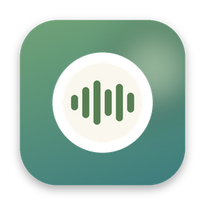
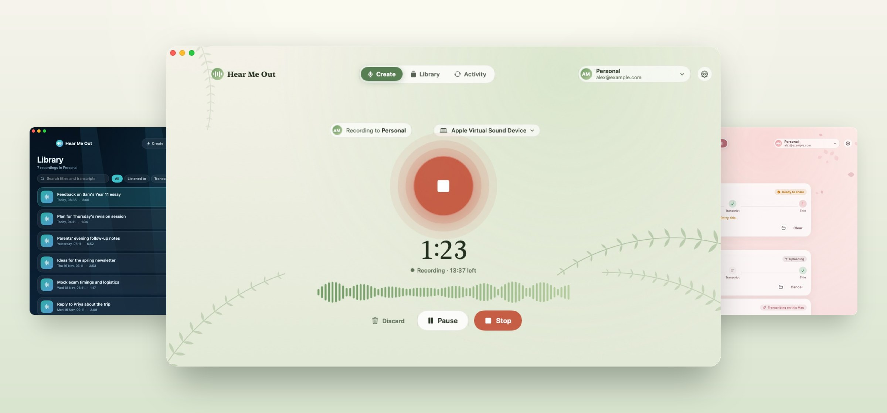
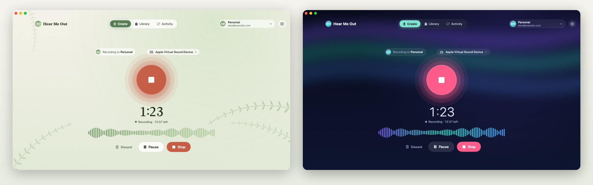
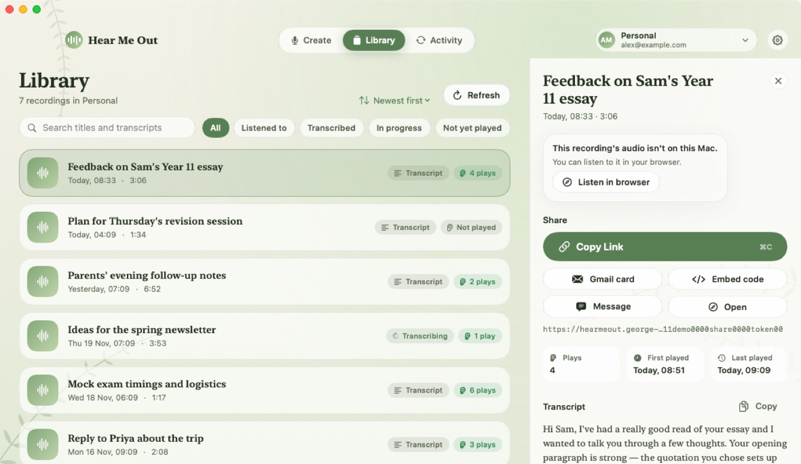
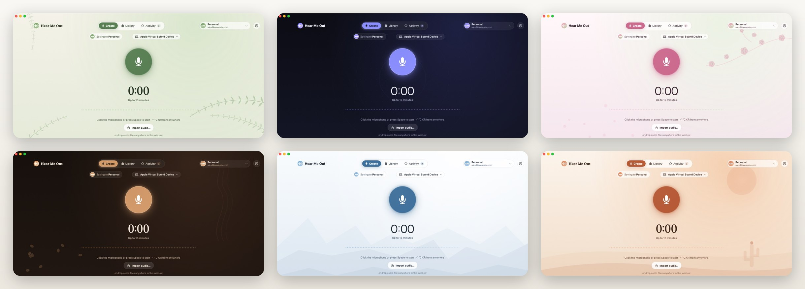
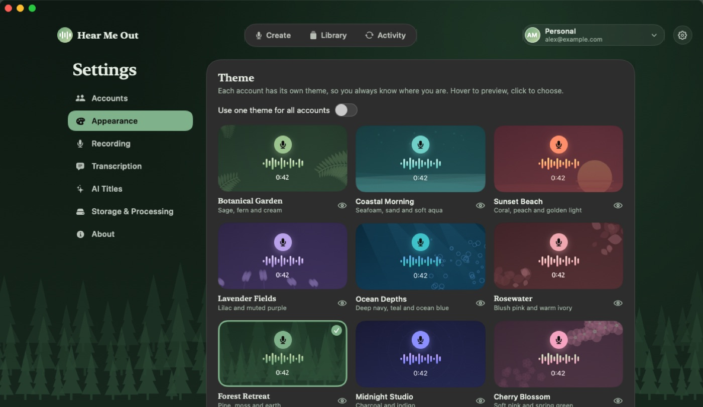

<div align="center">



# Hear Me Out for Mac

**Record a voice note. Share it in seconds.**<br>
A calm, beautiful, native Mac app for Hear Me Out — with private on-device transcription,<br>
three accounts at a click, and sixteen hand-made themes.

<br>

<a href="https://github.com/ghall702/HearMeOut-Mac/releases/latest/download/Hear-Me-Out.pkg"></a>
&nbsp;
<a href="https://github.com/ghall702/HearMeOut-Mac/releases/latest/download/Hear-Me-Out.dmg"></a>

<sub>Apple Silicon (M1 or later) · macOS 14 Sonoma or later · <a href="https://github.com/ghall702/HearMeOut-Mac/releases">all releases</a></sub>

<br>

[](https://github.com/ghall702/HearMeOut-Mac/actions/workflows/build-macos.yml)
[](https://github.com/ghall702/HearMeOut-Mac/releases/latest)


</div>

<br>

<p align="center">
  
</p>

<br>

## ⚡ Install in one minute

| | How | |
|---|---|---|
| 📦 | **[Download the installer (.pkg)](https://github.com/ghall702/HearMeOut-Mac/releases/latest/download/Hear-Me-Out.pkg)** — double-click it and click through. Hear Me Out lands in Applications. | *Easiest* |
| 💿 | **[Download the disk image (.dmg)](https://github.com/ghall702/HearMeOut-Mac/releases/latest/download/Hear-Me-Out.dmg)** — open it and drag Hear Me Out onto Applications. | *Classic* |
| ⌨️ | Paste into **Terminal**: `curl -fsSL https://github.com/ghall702/HearMeOut-Mac/releases/latest/download/install.sh \| bash` | *No clicks, no warnings* |

> [!NOTE]
> **The first time only:** Hear Me Out isn't notarised by Apple yet, so macOS may say it *can't verify the developer*.
> Open **System Settings → Privacy & Security**, scroll down and click **Open Anyway** next to the Hear Me Out message — then open the installer (or the app) again.
> The Terminal option skips this step. Every link above always fetches the newest build.

<br>

## 🎙️ Recording that just gets out of the way



Press the big button (or **Space**, or **⌃⌥⌘R** from any app) and talk. The waveform follows your voice, the timer counts calmly up, and the 15‑minute limit is handled for you.

- **Keeps recording** while you switch screens, apps or Spaces — the recorder lives outside the window.
- **Pick your microphone** right on the recording screen: built-in, USB, Bluetooth or audio interface, with live levels. It remembers your choice and falls back gracefully if you unplug it.
- **Pause, resume, listen back**, name it if you like, and press **Save & Share**. The upload starts instantly.
- **Drop audio files anywhere** in the window to import them — M4A, MP3, WAV, FLAC, AAC, OGG, Opus, WebM. The original recording date is read from the file where it's trustworthy.

<br>

## 🔗 A share link before you've finished thinking about it

<table>
<tr>
<td width="58%"></td>
<td>

Your recording goes **straight to your Hear Me Out storage**, and the link is ready the moment the server confirms it — transcripts and titles follow quietly afterwards.

**One click to copy:**
- 🔗 the listening link
- ✉️ a **Gmail-ready card** (rich HTML *and* plain text)
- 🧩 the **HTML embed**
- 💬 the friendly sharing message

The **Library** shows every recording with its transcript, play count and when it was first and last listened to. Search titles *and* transcripts, filter, sort and play back at any speed.

</td>
</tr>
</table>

<br>

## 🎨 Sixteen themes — one for each part of your life



Each of your accounts keeps **its own theme**, so you always know at a glance where a recording is going — Personal in *Botanical Garden*, Work in *Coastal Morning*, Tutoring in *Midnight Studio*. Switching account changes the whole room.

Every theme is a complete identity, not just an accent colour: its own palette in light **and** dark, typography, waveform colours and a restrained hand-drawn motif — ferns, waves, a low sun, lavender, light through water, petals, pines, studio panels, blossom, golden rays, mountains, dunes, wildflowers, linen, aurora and coffee steam.

<table>
<tr>
<td width="50%"></td>
<td width="50%"></td>
</tr>
<tr>
<td align="center"><sub><b>Theme gallery</b> — preview any theme before you choose it</sub></td>
<td align="center"><sub><b>Ocean Depths</b> in dark mode</sub></td>
</tr>
</table>

<br>

## 🔒 Private transcription, right on your Mac

<table>
<tr>
<td>

**Whisper runs on your Mac** (Apple Silicon, via WhisperKit). Only the finished transcript is sent to Hear Me Out — or choose cloud transcription, or none at all, per account.

**Already have Let's Meet Note Taker?** Hear Me Out reuses *its* Whisper model — no second multi-gigabyte download. Choose **Find Let's Meet's model**, select the folder once, and you're done. Nothing is copied, changed or deleted.

**Titles, your way:** Apple Intelligence (on-device), OpenAI with your own key (transcript only, never audio), Hear Me Out's cloud — or your own words. A title you type is never overwritten.

</td>
<td width="56%"></td>
</tr>
</table>

<br>

## 🔄 It just keeps going in the background

<table>
<tr>
<td width="56%"></td>
<td>

Close the window, lose Wi-Fi, quit the app — your recordings are safe. A durable queue picks up exactly where it left off: uploads resume, expired links are refreshed **without ever creating duplicates**, and anything that needs you is explained in plain English with a **Retry** button.

Each recording shows its journey: **Upload → Share link → Transcript → Title**.

</td>
</tr>
</table>

<br>

## 👥 Three accounts, one click

Sign in with Google once for each account. Switch from the account chip, the menu bar, or **⌃1 / ⌃2 / ⌃3** — theme, library and destination change together. A recording always stays with the account you started it in, and the screen always tells you where it's going.

<br>

## ✨ The little things

<table>
<tr>
<td width="50%"></td>
<td width="50%"></td>
</tr>
</table>

- A **welcome tour** that connects your accounts, picks a theme, tests your microphone and sets up transcription in under a minute.
- A **menu bar panel** to start and stop recording and copy your latest link without opening the window.
- **Global shortcuts** that need no extra permissions — ⌃⌥⌘R record, ⌃⌥⌘H open, ⌃⌥⌘L copy the latest link.
- Follows **Reduce Motion**, VoiceOver labels throughout, **British English** everywhere.
- **No analytics, no tracking.** Keys live in your Keychain; recordings that haven't uploaded are never deleted.

<br>

---

<details>
<summary><b>🛠️ How it works with Hear Me Out</b></summary>

<br>

It follows the Hear Me Out technical handbook exactly: `POST /uploads` → `PUT` the bytes directly to the media server with the returned ticket → `POST /recordings/:id/finalize`. The app never signs storage tokens and never sees the gateway secret. Each recording uses the API key of the account it belongs to.

To make links appear immediately, the first finalise is always `transcribe:false` (as the Chrome extension does). Local results follow in a second finalise:

| Transcription | Title | What's sent after the share link exists |
|---|---|---|
| On this Mac | Apple Intelligence / OpenAI | `transcript` + `title` + `titleIsAi:true` + `transcribe:false` |
| On this Mac | Hear Me Out | `transcript` only — the server writes the title |
| Cloud | Hear Me Out | `transcribe:true` — the server does both |
| Cloud | Apple Intelligence / OpenAI | `transcribe:true`, then (once the transcript is fetched) `title` + `titleIsAi:true` |
| None | — | nothing more (`transcribe:false`) |
| any | typed by you | your title, `titleIsAi:false`, never overwritten |

"Untitled recording" is never sent as a title. When the title will come from the Mac (or you chose manual titles), the first finalise carries a date-based name such as "Voice note · 21 Nov 2026, 09:30", so Hear Me Out's cloud titling — a provider you didn't choose — can't kick in. If title generation fails, the transcript is still attached and Activity offers **Retry title**; nothing is silently sent to another provider.

**Backend additions** (deployed 21 Nov 2026): native Google sign-in with PKCE, `GET /me` for profiles, and owner-only playback links. See [backend/README.md](backend/README.md) and the [handbook addendum](docs/HANDBOOK-ADDENDUM.md). The app checks for them at runtime and falls back to **Connect with an API key** on servers without them.

</details>

<details>
<summary><b>🧠 Reusing Let's Meet's Whisper model — the details</b></summary>

<br>

Let's Meet Note Taker (`com.georgehalltuition.lessonnotes`) uses **WhisperKit 1.1.1** and stores Core ML models in
`~/Library/Containers/com.georgehalltuition.lessonnotes/Data/Library/Application Support/LessonNotes/WhisperModels/models/argmaxinc/whisperkit-coreml/<variant>/`
(tokenizers sit alongside under `models/openai/…`). Hear Me Out pins the same WhisperKit version, so those models load unchanged.

Both apps are sandboxed, so Hear Me Out asks you to select `WhisperModels` once and keeps a *read-only* security-scoped bookmark. If the shared model disappears, transcription says so clearly and you can pick another. Models from other engines (whisper.cpp `ggml`, raw PyTorch/MLX weights) are detected and explained as incompatible rather than guessed at. Downloads into Hear Me Out's own folder happen only when you click, with the size shown first.

</details>

<details>
<summary><b>🏗️ Build from source</b></summary>

<br>

Requirements: macOS 15+ with **Xcode 26** (for Apple Intelligence titles; Xcode 16 also builds, without them), Apple Silicon, [XcodeGen](https://github.com/yonaskolb/XcodeGen).

```bash
brew install xcodegen
xcodegen generate
open HearMeOut.xcodeproj          # or build from the command line:
xcodebuild -project HearMeOut.xcodeproj -scheme HearMeOut -configuration Release \
  -destination 'platform=macOS,arch=arm64' -derivedDataPath build build
scripts/make-dmg.sh "build/Build/Products/Release/Hear Me Out.app" Hear-Me-Out.dmg
scripts/make-pkg.sh "build/Build/Products/Release/Hear Me Out.app" Hear-Me-Out.pkg 1.0.0
```

Core logic tests (every transcription/title combination, retries, account isolation, offline handling, PKCE, sharing formats, model discovery, persistence):

```bash
cd Packages/HearMeOutCore && swift test
```

Every push builds on GitHub Actions (macOS 15, Xcode 26): core tests, Release build (arm64), signature check, launch smoke test, DMG + PKG, and a GitHub Release with stable `latest` download links (the five newest builds are kept). Add `[shots]` to a commit message to recapture the screenshots in `docs/screenshots/` from the real build using demo data.

**Demo mode:** `HMO_DEMO=create|recording|library|activity|settings|themes|onboarding` launches with fictional sample data in a temporary folder — no real accounts, keys, recordings or network. `HMO_THEME=<id>` and `HMO_APPEARANCE=light|dark` pick the look.

</details>

<details>
<summary><b>✍️ Signing and notarisation</b></summary>

<br>

CI builds are **ad-hoc signed** — fine for your own Macs (see *Install* above). Because each build's signature differs, macOS may ask once to let a new build read its Keychain items; choose **Always Allow**.

For warning-free distribution, sign with a Developer ID and notarise:

```bash
xcodebuild … CODE_SIGN_IDENTITY="Developer ID Application: <Name> (<TEAMID>)" DEVELOPMENT_TEAM=<TEAMID> \
  OTHER_CODE_SIGN_FLAGS=--timestamp build
scripts/make-pkg.sh "…/Hear Me Out.app" unsigned.pkg 1.0.0
productsign --sign "Developer ID Installer: <Name> (<TEAMID>)" unsigned.pkg Hear-Me-Out.pkg
xcrun notarytool submit Hear-Me-Out.pkg --keychain-profile <profile> --wait
xcrun stapler staple Hear-Me-Out.pkg
```

Hardened Runtime and the App Sandbox are already enabled. Entitlements: microphone, outgoing network, user-selected files (import, model folder) and app-scoped bookmarks.

</details>

<details>
<summary><b>🔐 Privacy</b></summary>

<br>

- API keys and the OpenAI key live only in the Keychain (this device only). Keys and tokens are never logged.
- Local data is in the app's sandbox container with owner-only permissions (folders 0700, files 0600).
- Local transcription and Apple Intelligence keep everything on the Mac. Each account's settings say exactly what is sent where; OpenAI receives only a transcript excerpt, and only when you choose it.
- Unuploaded recordings are never deleted. Uploaded audio is cleared from the Mac after 30 days (configurable).
- No analytics, no third-party SDKs besides WhisperKit, nothing sent to Let's Meet.

</details>

<details>
<summary><b>📁 Project layout</b></summary>

<br>

```
App/Sources/            SwiftUI app
  AppModel.swift        accounts, themes, recording, library, sharing glue
  Audio/                device manager (Core Audio), recorder, player, importer
  Accounts/             native Google sign-in (PKCE), avatars
  Transcription/        WhisperKit engine, model library (Let's Meet reuse)
  Titles/               Apple Intelligence and OpenAI title generators
  Pipeline/             background uploads, services for the core engine
  Theme/                16 themes and illustrated motifs
  Views/                Create, Library, Activity, Settings, Onboarding, menu bar
Packages/HearMeOutCore/ API client, pipeline planner + engine, queue, sharing, model discovery (+ tests)
backend/                additive server endpoints for the Mac app (+ Lovable prompt)
docs/                   handbook addendum, screenshots, test plan
scripts/                DMG, PKG and one-line install scripts
```

</details>

<br>

<div align="center">
<sub>Made for Hear Me Out · British English throughout · <a href="docs/TEST-PLAN.md">Test plan</a> · <a href="docs/HANDBOOK-ADDENDUM.md">Handbook addendum</a></sub>
</div>
